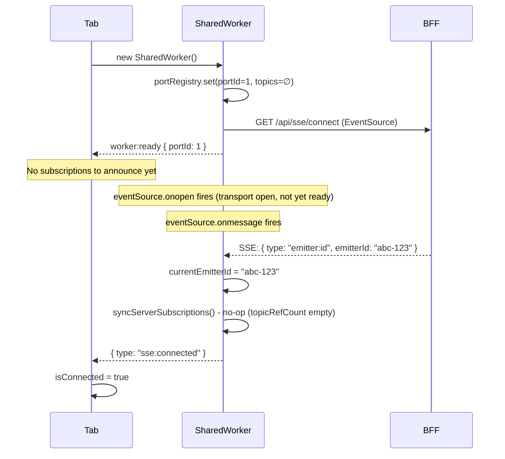
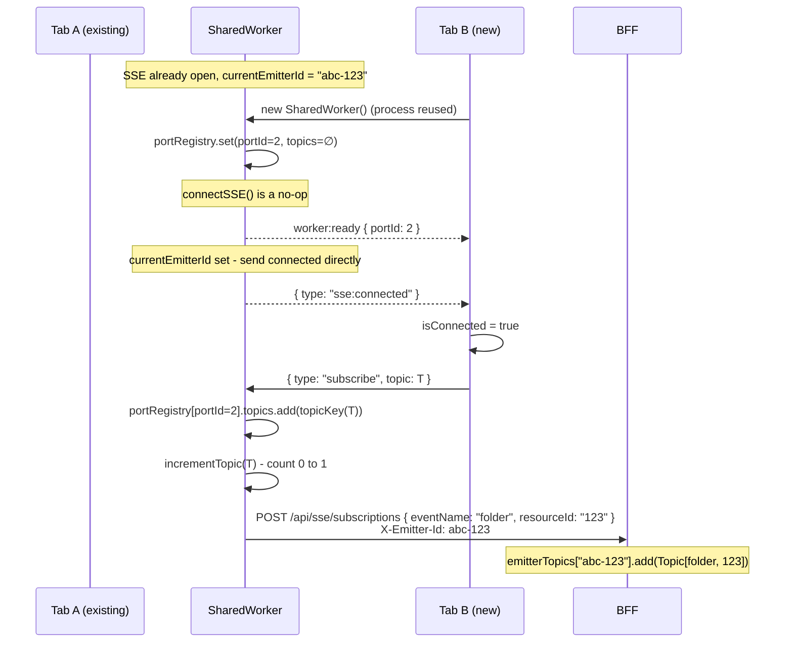
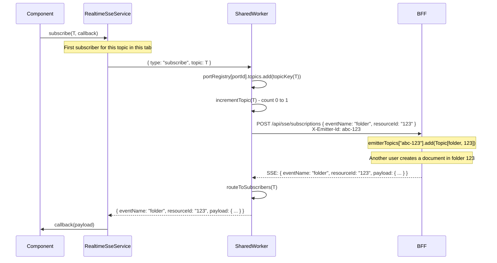
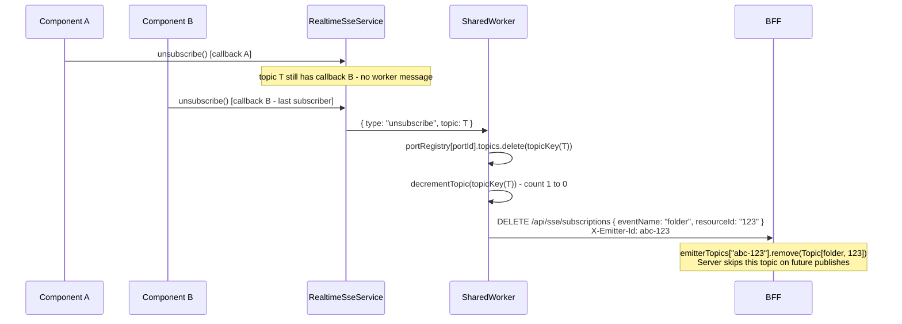
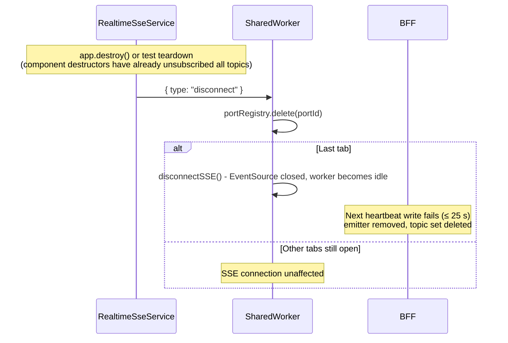
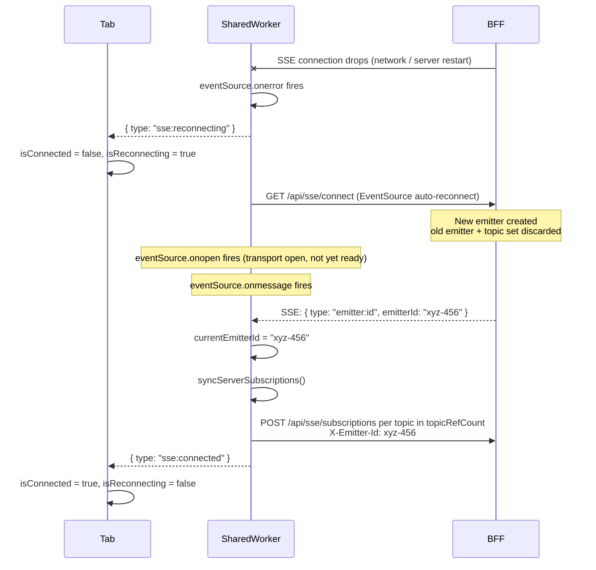
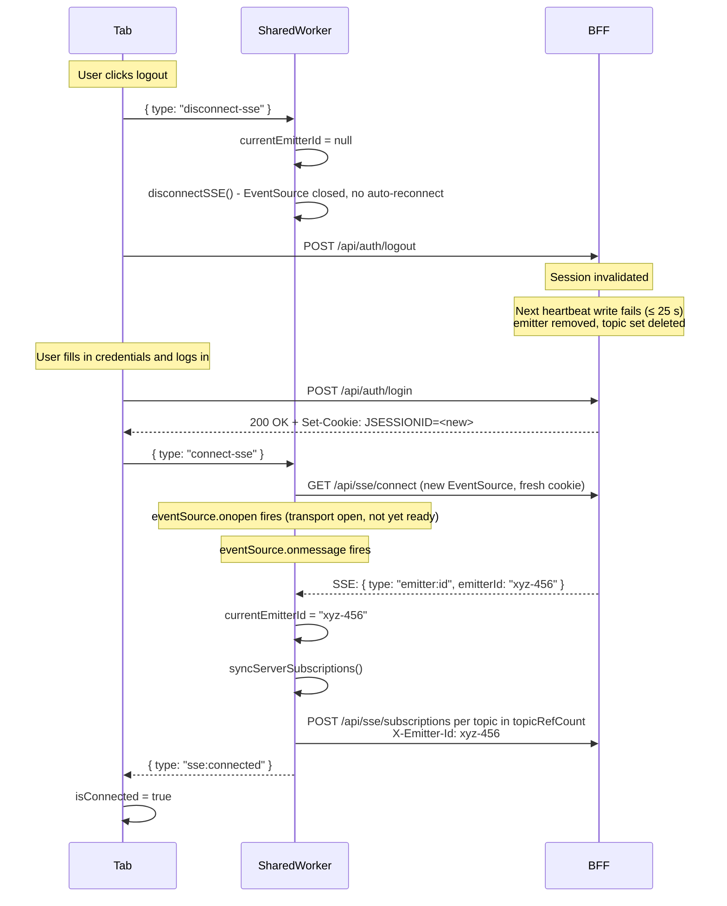
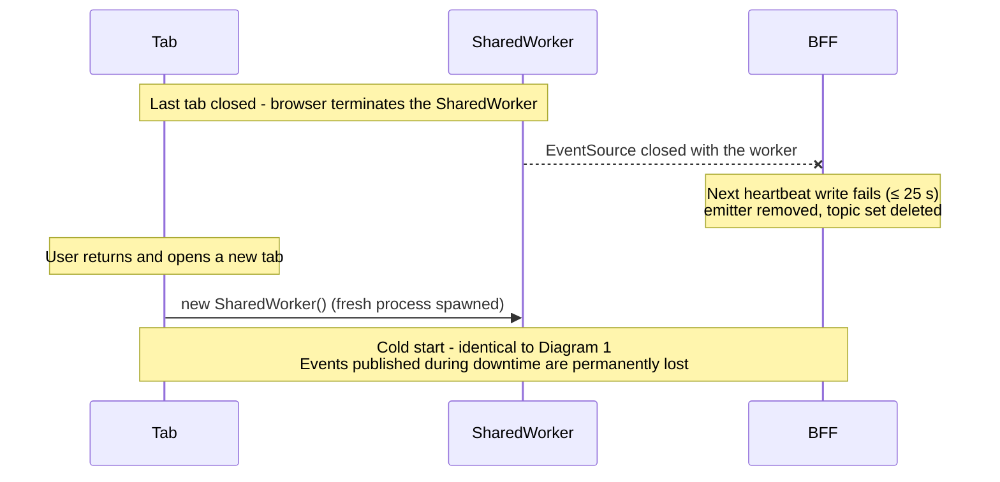
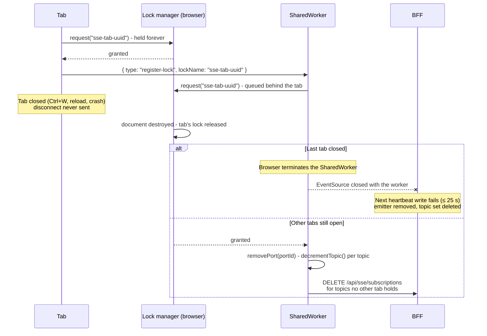

# SSE Sequence Diagrams

Visual representation of all lifecycle scenarios. See `EVENTS-GUIDE.md` for detailed
written descriptions.

`T` stands for the topic `{ eventName: "folder", resourceId: "123" }`. Maps in the
service and the worker are indexed by its `topicKey`, `'["folder","123"]'`.

---

## 1. First Tab - Connection & Emitter ID

No SharedWorker exists yet. The browser spawns a fresh process, opens the SSE connection,
and the server assigns an emitter ID.

---

## 2. Second Tab - Reusing the Existing Worker

The SharedWorker is already running. No new SSE connection is created. `sse:connected`
is sent directly to the new port because `currentEmitterId` is already set.

---

## 3. Subscription & Event Delivery

How a component subscribes and receives a routed event end-to-end.

---

## 4. Unsubscribing From a Topic

The last component for a topic unsubscribes. The worker notifies the server only if no other tab is still subscribed.

---

## 5. Graceful App Teardown

The Ember application is explicitly destroyed (e.g. `app.destroy()` or test teardown).
Component destructors fire first, unsubscribing all topics before the service destructor
sends `disconnect`. In-app route transitions do not trigger this path — the service is
application-scoped and stays alive for the entire session.

---

## 6. SSE Connection Drop & Reconnect

Network error or server restart. `EventSource` auto-reconnects, a new emitter is created,
and topics are re-registered with the server.

---

## 7. Logout & Re-login

SSE is closed before session invalidation, because logout does not close the stream on the
server and it would keep delivering the old user's events. A new emitter is assigned after
successful re-authentication.

---

## 8. Total Downtime & Fresh Restart

All tabs are closed so the browser terminates the SharedWorker. When the user returns and
opens a new tab, the system performs a full cold start identical to Diagram 1. Any events
published by the server during the downtime window are permanently lost.

---

## 9. Hard Tab Close - Lifetime Lock

The tab is closed with no `disconnect` message, and posting to its port would not throw.
The worker learns about it from the tab's Web Lock instead (see Scenario 9 in
`EVENTS-GUIDE.md`).

